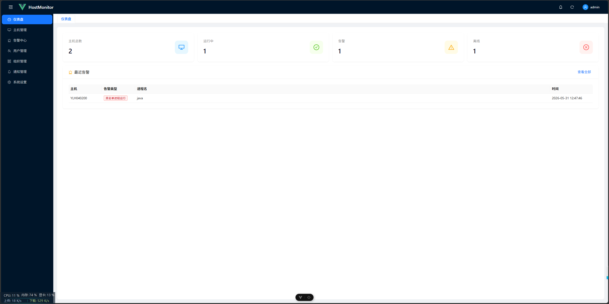
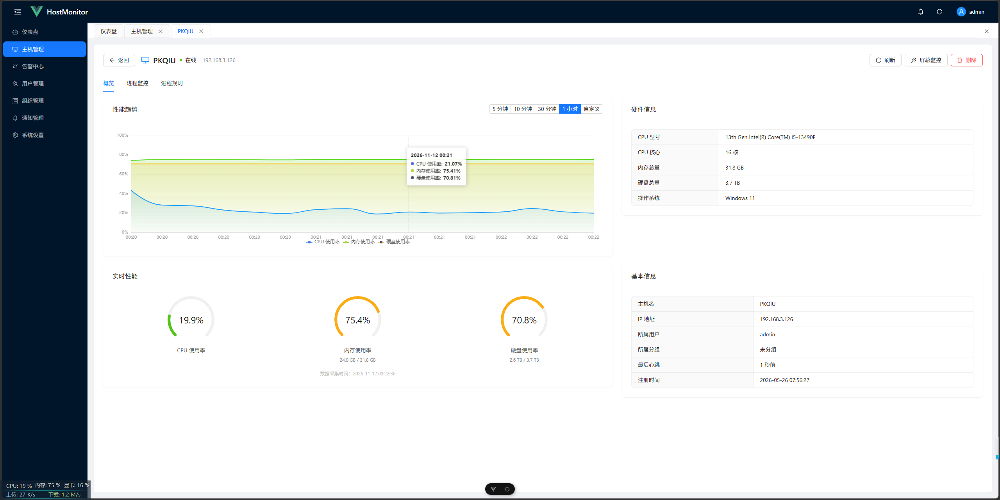
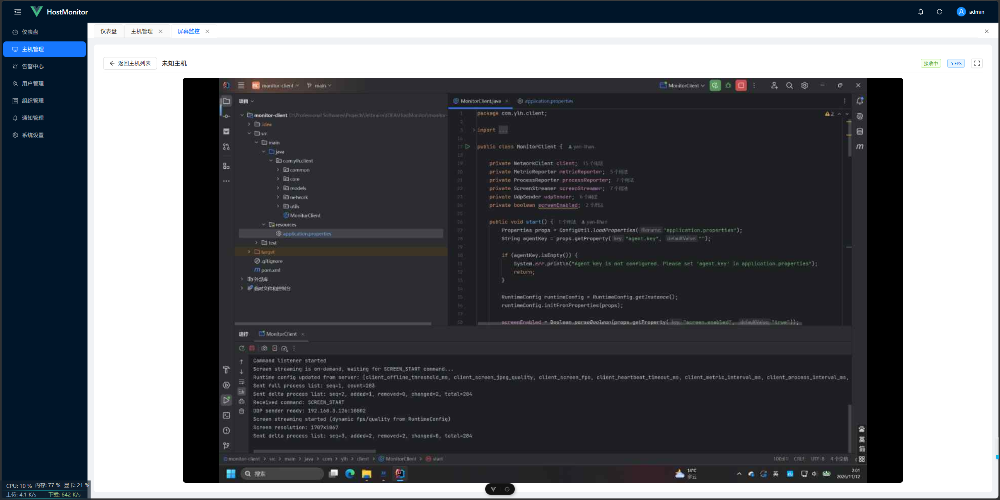

# HostMonitor 主机监控与远程管理系统

基于 C/S 架构的主机监控系统：Java 客户端（Agent）采集主机指标与进程数据，
通过 TCP/UDP 加密链路上报；Spring Boot 服务端完成存储、告警与推送；
Vue 3 前端提供可视化大屏与实时屏幕查看。





## 功能特性

| 模块     | 能力                                                         |
| -------- | ------------------------------------------------------------ |
| 主机监控 | CPU / 内存 / 磁盘 / 网络指标采集，采集间隔服务端可配（默认 5s） |
| 进程监控 | 进程全量 + 增量上报，黑白名单规则告警                        |
| 屏幕监控 | 客户端截屏 → UDP 加密传输 → WebSocket 实时推流，帧率 / 画质可配 |
| 告警中心 | 性能阈值 + 进程规则双通道告警，去重窗口、站内通知、异步邮件  |
| 权限管理 | RBAC 三级角色（超管 / 组管 / 用户）、分组管理、Agent Key 绑定 |
| 安全防护 | ECDH + AES-256-GCM 通信加密、登录防爆破三层防护、JWT 认证    |
| 配置中心 | 全局配置 + 组级覆盖，长连接下发、客户端热更新免重启          |

## 技术栈

| 端     | 技术                                                         |
| ------ | ------------------------------------------------------------ |
| 服务端 | Java 21、Spring Boot 3.4、Spring Security、MyBatis-Plus、MySQL 8、WebSocket |
| 客户端 | Java 21、OSHI（硬件指标采集）、AWT（屏幕截屏）、Gson         |
| 前端   | Vue 3、TypeScript、Ant Design Vue、ECharts、Pinia、Vite      |
| 通信   | TCP（长连接 + 自定义协议）、UDP（屏幕帧）、HTTP REST、WebSocket |

## 系统架构

- TCP 10801：认证、指标/进程上报、指令下发、配置推送，认证后 AES-256-GCM 加密
- UDP 10802：屏幕帧传输，帧数据加密
- HTTP 10800：前端常规接口；WebSocket：前端订阅屏幕画面

## 快速开始

1. 建库并导入脚本：`CREATE DATABASE host_monitor ...`，然后 `mysql -u xxx -p host_monitor < sql/init.sql`
2. 启动服务端：`cd backend && mvn spring-boot:run`（HTTP 10800 / TCP 10801 / UDP 10802）
3. 启动前端：`cd frontend && npm install && npm run dev`（5173）
4. 启动客户端：`cd monitor-client && mvn spring-boot:run`（配置服务端地址与 Agent Key）

默认管理员账号见 `sql/init.sql`，为提高安全性，建议首次登录后请修改密码。

## 核心设计

- **自定义通信协议**：`TYPE|JSON\n` 文本协议，统一管理认证、指标、进程、指令、配置等消息；
  进程上报支持全量 + 增量（added / removed / changed）与 seq 重同步。
- **通信加密**：认证阶段交换 X25519 公钥推导 AES-256 密钥，后续 TCP/UDP 消息逐条加密，
  每条消息独立 12 字节随机 IV；协商失败自动降级明文保证兼容。
- **权限体系**：JWT 携带角色避免重复查库，权限校验统一收口 `AccessChecker`；
  实现 IP 限速、算术验证码、账号锁定三层登录防护。
- **告警链路**：指标入库触发检测 → 组级/全局阈值 → 去重窗口 → 告警记录 + 站内通知 + 异步邮件。
- **配置热更新**：组级设置覆盖全局配置，变更经 TCP 长连接实时推送，采集间隔/帧率等参数免重启生效。

> 详细设计见 [docs/](docs/)。

## 项目结构

```
backend/         # 服务端：Spring Boot 3.4 + MyBatis-Plus + TCP/UDP/WebSocket
monitor-client/  # 客户端：指标采集、进程采集、屏幕推流、加密传输
frontend/        # 前端：Vue 3 + TypeScript + Ant Design Vue + ECharts
sql/             # 数据库初始化脚本
docs/            # 架构、协议、接口、部署文档
```

## 文档

| 文档                 | 内容                         |
| -------------------- | ---------------------------- |
| docs/architecture.md | 系统架构、通信协议、告警流程 |
| docs/api.md          | 接口清单                     |
| docs/deployment.md   | 部署与配置说明               |
