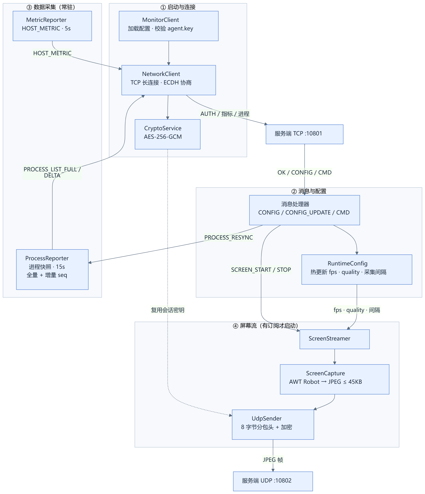
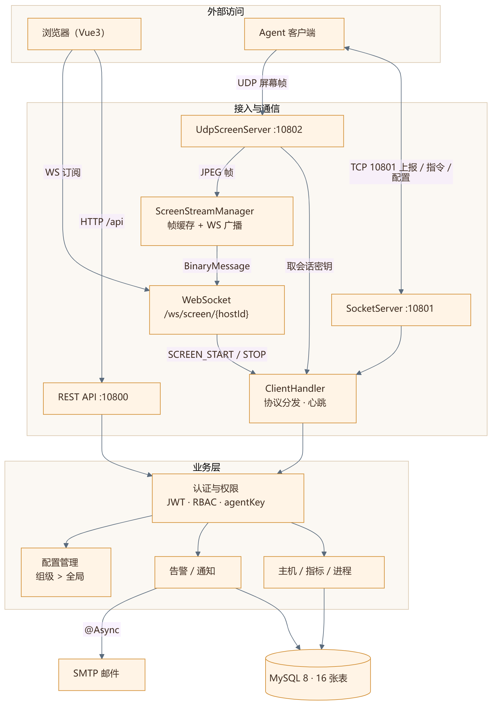
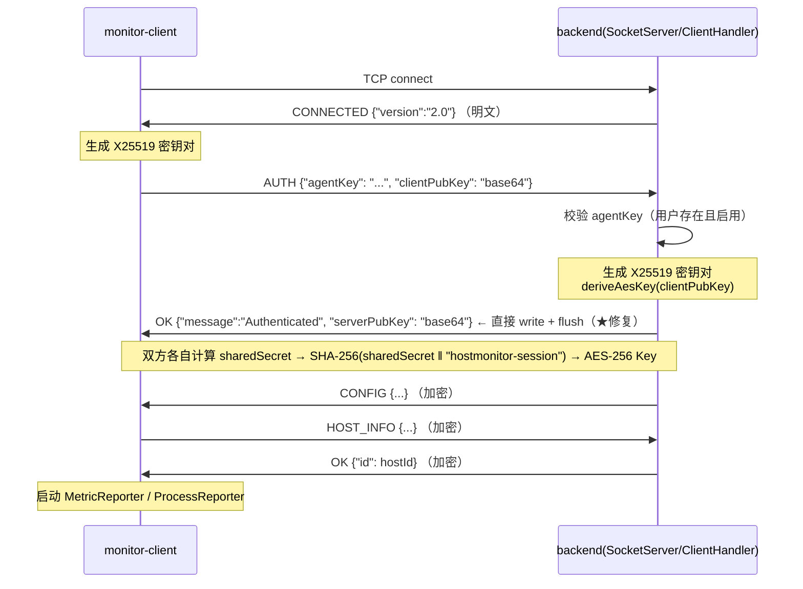
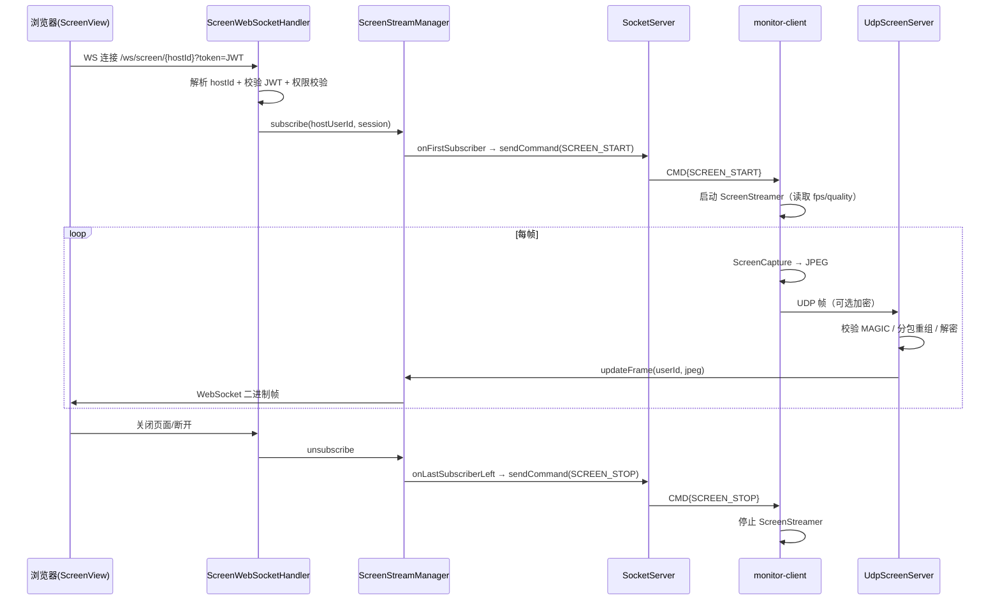

# HostMonitor 系统架构设计

> 本文档描述 HostMonitor 的整体架构、通信协议与关键链路设计。
>
> - 适用代码：`master` 分支，提交 `77e7f86`（修复客户机画面无法被接收的问题）及之后
> - 最后更新：2026-11-12
> - 关联文档：`README.md`（项目概览与快速开始）
> - 后续规划：`docs/security.md`、`docs/database.md`、`docs/api.md`、`docs/deployment.md`（可按需从本文档拆分）

---

## 1. 系统定位

HostMonitor 是一个**面向内网/小组场景的主机监控与远程管理系统**，采用 C/S + B/S 混合架构：

- **采集端（monitor-client）**：部署在被监控主机上，常驻后台，负责上报主机信息、性能指标、进程列表，并按需推流屏幕画面。
- **服务端（backend）**：承接采集端长连接，负责数据落库、阈值告警、配置下发、屏幕帧转发，同时为前端提供 REST API 与 WebSocket 通道。
- **前端（frontend）**：Vue 3 单页应用，提供主机列表、监控大屏、主机详情、屏幕观看、告警、用户/组管理、系统设置等界面。

设计目标按优先级排序：

1. **实时性**：指标秒级上报，屏幕画面可实时观看。
2. **低侵入**：采集端为普通 Java 进程，无需 root/管理员权限即可采集大部分指标。
3. **可扩展**：协议自描述、消息类型可扩展，新增指标/命令不破坏旧客户端。
4. **可审计**：登录、告警、操作均有记录，权限分级。

---

## 2. 总体架构

### 2.1 采集端（客户端）



### 2.2 服务端（后端+前端）



核心思想是**控制面与数据面分离**：

| 通道 | 承载 | 用途 | 特性要求 |
| --- | --- | --- | --- |
| TCP 长连接（10801） | 自定义 `TYPE\|JSON\n` 协议 | 认证、心跳、指标上报、进程上报、命令与配置下发 | 可靠、有序、可加密 |
| UDP（10802） | 自定义二进制帧 | 屏幕 JPEG 画面 | 低延迟、可丢帧、不重传 |
| WebSocket（`/ws/screen/{hostId}`） | 二进制帧 | 服务端 → 浏览器实时推流 | 浏览器原生支持、可鉴权 |
| HTTP REST（10800） | JSON | 登录、主机/进程/告警/用户/组/设置等管理接口 | 无状态、JWT 鉴权 |

之所以不用 MQTT/gRPC/Netty：项目目标是**教学与可读性优先**，用 JDK 原生 Socket + 自研轻量协议即可覆盖需求，同时把"协议设计、粘包处理、加密协商、分包重组"这些底层问题完整暴露出来，便于学习与面试讲解。生产化演进方向见第 16 节。

---

## 3. 部署形态与端口

| 组件 | 进程/产物 | 端口 | 说明 |
| --- | --- | --- | --- |
| backend | Spring Boot 可执行 Jar | 10800（HTTP）、10801（TCP Socket）、10802（UDP Screen） | 三个端口同一个进程，共享 Spring 容器 |
| monitor-client | 可执行 Jar | 随机本地端口 | 主动连接服务端，无需对外开放端口 |
| frontend | 静态资源（Nginx 托管） | 5173（Vite 开发） | 生产环境由 Nginx 托管 `dist/`，`/api` 与 `/ws` 反代到后端 |

数据存储：MySQL 8（库名 `host_monitor`）。缓存：无独立缓存中间件，服务端使用 `ConcurrentHashMap` + 定时清理（验证码、登录尝试、分组配置缓存等）。

---

## 4. 模块划分

### 4.1 服务端（`backend`，包 `com.ylh.backend`）

| 包 | 职责 | 关键类 |
| --- | --- | --- |
| `Controller` | REST 接口层 | `AuthController`、`HostInfoController`、`HostProcessController`、`AlertController`、`AlertSettingController`、`ProcessRuleController`、`GroupController`、`GroupSettingController`、`NotificationController`、`UserController`、`SystemSettingController` |
| `Service` | 业务逻辑 | `AuthService`（登录/防爆破）、`CaptchaService`（数学验证码）、`HostInfoService`、`HostProcessService`、`AlertService`、`AlertSettingService`、`NotificationService`、`EmailService`（`@Async`）、`GroupSettingService`（组级覆盖）、`LoginAttemptService` |
| `Socket` | TCP/UDP/WS 接入与协议 | `SocketServer`、`ClientHandler`、`UdpScreenServer`、`ScreenStreamManager`、`ScreenWebSocketHandler`、`WebSocketConfig`、`CryptoService`、`SocketMessage`、`MessageParser`、`MessageConstants` |
| `Entity` / `Mapper` | 数据模型与持久化 | 16 张表对应实体（见第 13 节） |
| `Config` | Spring 与基础设施配置 | `SecurityConfig`、`WebSocketConfig`、`JwtAuthenticationFilter`、`JwtUtil`、`AccessChecker`、`GlobalExceptionHandler`、`DataCleanupTask`、`MyBatisMetaObjectHandler` |
| `Common` | 统一响应与异常 | `Result`、`PageResult`、`BusinessException`、`UnauthorizedException`、`ForbiddenException`、`NotFoundException` |

### 4.2 采集端（`monitor-client`，包 `com.ylh.client`）

| 类 | 职责 |
| --- | --- |
| `MonitorClient` | 入口：读配置、连接、认证、启动各上报线程、注册命令处理器 |
| `NetworkClient` | TCP 连接管理、认证、加密收发、**按行切分的接收缓冲**（修复粘包） |
| `MetricReporter` | 周期性采集并上报性能指标 |
| `ProcessReporter` | 进程全量/增量上报，含 `seq` 与重同步请求 |
| `ScreenStreamer` | 按需启动的屏幕推流线程，逐帧读取动态参数 |
| `ScreenCapture` | AWT Robot 截屏、缩放、JPEG 压缩（体积自适应） |
| `UdpSender` | 屏幕帧 UDP 封装、加密、单包/分包发送 |
| `RuntimeConfig` | 运行期配置单例，支持服务端热更新 |

### 4.3 前端（`frontend`）

Vue 3.5 + TypeScript + Vite 8 + Pinia + Vue Router + Ant Design Vue + ECharts。

- `views/`：`Dashboard`、`Hosts`、`HostDetail`、`ScreenView`、`Alerts`、`ProcessManagement`、`Users`、`Groups`、`Notifications`、`Settings`、`Login`、`Register`。
- `utils/request.ts`：Axios 实例，统一注入 JWT、拦截 401/403 并跳转登录。
- `router/`：路由守卫，未登录跳登录页，按角色隐藏菜单。
- `stores/`：`user`（登录态与权限）、`tabs`（多页签状态）。
- `ScreenView.vue`：WebSocket 订阅屏幕流，Canvas 渲染，帧积压保护（见 9.5）。

---

## 5. 通信协议总览

| 通道 | 帧格式 | 编码 | 加密 |
| --- | --- | --- | --- |
| TCP 控制通道 | `TYPE\|JSON_BODY\n` | UTF-8 | 认证后 AES-256-GCM（见第 8 节） |
| UDP 屏幕通道 | 二进制：`MAGIC + keyLen + agentKey + chunkHeader + payload` | 原始字节 | payload 为 AES-256-GCM 密文（`iv‖ciphertext‖tag`） |
| WebSocket | 二进制消息（JPEG 原始字节） | 无 | 依赖 `wss` 或反代 TLS |
| HTTP | JSON | UTF-8 | 生产环境走 HTTPS |

设计要点：

1. **按行分帧**：TCP 是字节流，必须显式分帧。统一以 `\n` 结束，接收端维护持久 `StringBuilder` 缓冲，按 `\n` 切出完整行再解析——这是本次修复粘包问题的核心。
2. **类型前置**：`TYPE|` 前缀让服务端无需先反序列化即可路由；`|` 只取第一个，JSON 内部可安全包含 `|`。
3. **单条上限**：TCP 单条消息最大 10MB，超限清空缓冲并断开，防止内存被打爆。
4. **UDP 自描述**：每个 UDP 包都携带 `agentKey` 与分包头，服务端无需维护"包序号 → 会话"的外部状态，丢包也不会污染后续帧。

---

## 6. 连接建立与身份认证

### 6.1 时序



### 6.2 步骤说明

1. **接受连接**：`SocketServer` 的 accept 循环以 5s `SO_TIMEOUT` 接受连接，分配自增 `connectionId`，交给固定大小线程池（50）中的 `ClientHandler` 处理。
2. **下发欢迎帧**：`ClientHandler` 一进来先发明文 `CONNECTED`，告知协议版本，便于客户端与旧版本兼容。
3. **客户端认证**：客户端生成 X25519 密钥对，发送 `AUTH{agentKey, clientPubKey}`。
4. **服务端校验**：`userService.getByAgentKey(agentKey)` 校验用户存在且状态正常；失败发 `ERROR` 并断开。
5. **密钥协商**：服务端生成自己的 X25519 密钥对，用客户端公钥派生共享密钥，回 `OK{serverPubKey}`。
6. **认证成功后的动作**（顺序重要）：
   - 记录 `authenticatedUserId`，状态置 `AUTHENTICATED`；
   - `kickExistingConnection`：同一用户重复登录时踢掉旧连接（单设备登录）；
   - 注册 `userId → connectionId` 映射；
   - **直接写 `OK` 并 flush**：这是本次修复点——旧实现复用了"未认证状态下不 flush"的发送方法，导致客户端一直阻塞在 `readLine()` 上，表现为"启动后卡住、画面收不到"；
   - 下发该用户生效的客户端配置（`CONFIG`），配置来自全局设置与组级设置的合并结果；
   - `notifyClientConnected`：若该用户已有屏幕订阅者，补发 `SCREEN_START`，保证"先打开观看页、后上线客户端"也能自动起流。
7. **心跳与超时**：
   - 认证超时 30s：未在 30s 内完成认证则发 `ERROR("Auth timeout")` 并断开；
   - 心跳检查线程每 30s 扫描一次，`lastActiveTime` 超过 `client_heartbeat_timeout_ms`（默认 60s）则关闭连接；
   - 连接关闭时若该用户已无任何连接，将主机置为离线（`host.status = 0`）。

### 6.3 降级策略

加密协商失败（客户端无公钥、算法异常、版本不匹配）时，双方回退为**明文模式**继续通信，保证旧客户端可用；服务端通过 `isEncryptionEnabled()` 标记当前连接是否加密，后续所有发送自动按开关处理。

---

## 7. 消息帧格式与消息类型

### 7.1 线格式

```text
TYPE|JSON_BODY\n
```

例：

```text
HOST_METRIC|{"cpuUsage":12.5,"memoryUsage":43.1,...}\n
ENCRYPTED|{"iv":"","ciphertext":"base64(iv+cipher+tag)"}\n
```

### 7.2 消息类型

**采集端 → 服务端**

| 类型 | 载荷 | 说明 |
| --- | --- | --- |
| `AUTH` | `agentKey`, `clientPubKey` | 认证与密钥协商 |
| `HOST_INFO` | 主机名、OS、CPU、内存、磁盘等 | 上线/变更时上报；服务端 upsert 并回 `OK{id}` |
| `HOST_METRIC` | CPU/内存/磁盘/网络、采集时间 | 默认 5s 一条 |
| `PROCESS_LIST` | 进程数组 | 兼容旧版的全量上报 |
| `PROCESS_LIST_FULL` | `seq`, 进程数组 | 首次上报或重同步后的全量快照 |
| `PROCESS_LIST_DELTA` | `seq`, `added`, `removed`, `changed` | 增量上报，默认 15s 一条 |
| `ENCRYPTED` | `iv`, `ciphertext` | 加密外壳，内部再套上述任一类型 |

**服务端 → 采集端**

| 类型 | 载荷 | 说明 |
| --- | --- | --- |
| `CONNECTED` | `version` | 连接建立后的欢迎帧（明文） |
| `OK` | `message`, 可选 `serverPubKey` / `id` | 成功响应 |
| `ERROR` | `message` | 错误响应，通常随后断开 |
| `CONFIG` | 客户端配置键值 | 认证成功后下发 |
| `CMD` | `command`，或 `command + config` | 命令与配置热更新 |
| `PROCESS_RESYNC` | `seq` | 通知客户端重发全量进程快照 |
| `ENCRYPTED` | `iv`, `ciphertext` | 加密外壳 |

### 7.3 命令字

| 命令 | 触发方 | 作用 |
| --- | --- | --- |
| `SCREEN_START` | 服务端（首个观看者订阅） | 启动屏幕推流 |
| `SCREEN_STOP` | 服务端（最后一个观看者离开） | 停止屏幕推流，省 CPU/带宽 |
| `PROCESS_RESYNC` | 服务端（检测到 seq 不连续） | 客户端重发全量进程 |
| `CONFIG_UPDATE` | 服务端（管理员改设置） | 热更新客户端参数 |

---

## 8. 传输加密

### 8.1 算法与参数

| 项 | 取值 |
| --- | --- |
| 密钥交换 | X25519 ECDH |
| 对称加密 | AES-256-GCM（`AES/GCM/NoPadding`） |
| IV | 12 字节，每条消息用 `SecureRandom` 重新生成 |
| Tag | 128 位 |
| 密钥派生 | `SHA-256(sharedSecret ‖ "hostmonitor-session")` |
| 密文编码 | TCP：`base64(iv ‖ ciphertext ‖ tag)`；UDP：原始字节 `iv ‖ ciphertext ‖ tag` |

### 8.2 设计说明

1. **每连接独立密钥**：ECDH 每次连接重新协商，不使用静态密钥，降低长期密钥泄露的影响面。
2. **逐条随机 IV**：GCM 的 IV 复用会导致灾难性的明文恢复与认证失效，这里每条消息都重新生成 IV，且 IV 随密文一起传输，服务端解密时无需额外状态。
3. **UDP 复用 TCP 密钥**：屏幕帧量大，若每帧单独握手成本过高；UDP 直接使用该连接已协商好的 AES 密钥加密，服务端通过 `agentKey → userId → CryptoService` 找到对应密钥。
4. **降级不等于无保护**：降级为明文仅用于兼容旧客户端，正常部署应保证所有客户端均支持 ECDH。

> 当前限制：ECDH 未绑定服务端身份（无证书/预置公钥），理论上可被中间人攻击；生产化建议为服务端配置固定密钥对并内置到客户端，或直接使用 TLS。见第 16 节。

---

## 9. 屏幕画面链路

### 9.1 触发与生命周期

屏幕推流是**按需启动**的：没有观看者时不采集、不发送，避免空转。



### 9.2 客户端采集与编码（`ScreenCapture`）

- 使用 AWT `Robot` 截取屏幕，初始化时汇总所有 `GraphicsDevice` 的 bounds，**支持多显示器**。
- `MAX_WIDTH = 1280`：宽度超过则等比缩放（双线性插值），控制单帧体积。
- 质量自适应：先按当前 quality 压缩；若 JPEG 超过 `TARGET_SIZE = 45000` 字节且 quality 仍大于 0.2，则按 `quality × 45000 / 实际长度` 下调质量（下限 0.15）重压一次。
- 使用 `ImageIO` 的 JPEG `ImageWriter` + `MODE_EXPLICIT` 显式设置压缩质量。
- 帧参数（fps、quality）**每帧从 `RuntimeConfig` 读取**，因此服务端修改配置后无需重连即可生效。

### 9.3 UDP 封装（`UdpSender`）

每个 UDP 包结构统一如下：

| 偏移 | 长度 | 字段 | 说明 |
| --- | --- | --- | --- |
| 0 | 4 | `MAGIC` | `0x5343524E`（ASCII "SCRN"），快速丢弃非法包 |
| 4 | 4 | `keyLen` | `agentKey` 字节长度（服务端限制 1..128） |
| 8 | keyLen | `agentKey` | 用于定位用户/会话密钥 |
| 8+keyLen | 4 | `totalChunks` | 本帧分包总数 |
| 12+keyLen | 4 | `chunkIndex` | 当前分包序号（从 0 开始） |
| 16+keyLen | 变长 | `payload` | 加密后的 JPEG（`iv‖cipher‖tag`）或明文 |

分包规则：

- 单包上限 `MAX_UDP_SIZE = 60000` 字节（预留 UDP/IP 头部，避免 IP 分片）。
- `headerSize = 4 + 4 + keyLen`，`chunkMetaSize = 8`。
- 若 `headerSize + 8 + payload ≤ 60000`：单包发送，`totalChunks = 1`、`chunkIndex = 0`。
- 否则 `chunkPayloadSize = 60000 - headerSize - 8`，`totalChunks = ceil(payload / chunkPayloadSize)`，逐块发送；**每个分包都重复携带 MAGIC、keyLen、agentKey 与分包头**，保证任意包到达都能自解释。

> ★ 本次修复的核心：旧实现里单包**不带**分包头、分包**带**分包头，服务端只能靠"长度是否大于 headerSize+8"猜测，一旦 JPEG 前 8 字节恰好被当成 `totalChunks/chunkIndex`，画面就会被截断或丢弃——表现为"画面一直收不到/花屏"。现在**单包与分包统一携带 8 字节分包头**，格式自描述，服务端无需猜测。

### 9.4 服务端收帧、重组与转发

1. **合法性校验**：长度 ≥ 8、MAGIC 匹配、keyLen 合法，否则直接丢弃。
2. **定位用户**：解析 `agentKey`，先用本地缓存 `agentKeyCache` 查，未命中再查库（避免每帧打数据库）。
3. **订阅者过滤**：`ScreenStreamManager.hasSubscribers(userId)` 为 false 时直接丢弃——没有观看者就不做解密和转发，节省 CPU。
4. **分包重组**：`totalChunks <= 1` 直接取 payload；否则按 `userId` 维护 `ChunkBuffer(ConcurrentHashMap<chunkIndex, byte[]>)`，攒齐后按序拼接。清理线程每 3s 回收超过 2s 未完成的缓冲，防止内存泄漏。
5. **解密**：通过 `SocketServer.getHandlerByUserId(userId)` 取到该连接的 `CryptoService`，调用 `decryptUdp` 还原 JPEG；未启用加密或解密异常则按明文处理。
6. **转发**：`ScreenStreamManager.updateFrame` 只保留每个用户的最新一帧，并向所有 `open` 的 WebSocket 会话广播 `BinaryMessage`。慢消费者不会造成队列积压，只会丢帧——这正是实时监控需要的语义。

### 9.5 前端渲染（`ScreenView.vue`）

- 连接地址：`${protocol}//${host}/ws/screen/${hostId}?token=${JWT}`，`protocol` 随页面在 `ws/wss` 间自动切换；连接成功即视为订阅成功。
- 收到 `ArrayBuffer` → `Blob` → `createImageBitmap`/`Image` 解码 → 绘制到 `Canvas`。
- **积压保护**：`pendingData` 只保留最新一帧，用 `requestAnimationFrame` 调度绘制；解码慢时旧帧被覆盖，避免"越看越延迟"。
- 断线后 3 秒自动重连；组件卸载时关闭连接、清理定时器与重连任务。

### 9.6 带宽与性能估算

以默认参数（fps=5、quality=0.5、1280 宽）为例，单帧约 30~60KB，则单主机单观看者约 **1.2~2.4 Mbps**；同屏 10 台主机重点观看约 12~24 Mbps。实际部署建议：

- 内网/同机房：可直接使用默认参数；
- 跨公网：调低 fps 至 2~3 或 quality 至 0.3，或只对"当前查看的那台"推流（本项目已按订阅者粒度启停）。

---

## 10. 指标与进程采集链路

### 10.1 性能指标

- `MetricReporter` 每 `metric.interval.ms`（默认 5000ms）采集一次，通过 `HOST_METRIC` 上报。
- 服务端 `ClientHandler` 收到后：写入 `host_metric`；每 30s 节流更新一次 `host.last_heartbeat`；每 30s 节流执行一次 `alertService.checkPerformanceAlerts(hostId, metric)`。

### 10.2 进程列表

- 首次上报 `PROCESS_LIST_FULL`（带 `seq`），之后上报 `PROCESS_LIST_DELTA`（`added/removed/changed`）。
- 客户端用 `ProcessDeltaCalculator.compute(lastSnapshot, current, seq, cpuThreshold)` 计算差异，`process.cpu.threshold`（默认 1.0）用于过滤掉 CPU 占用可忽略的微小波动，避免增量噪音。
- 服务端维护 `processSnapshot` 与 `expectedProcessSeq`：
  - `seq` 连续：按 `added/removed/changed` 更新快照，`expectedProcessSeq++`；
  - `seq` 不连续（丢包/重连/客户端重启）：清空快照、`expectedProcessSeq = 1`，下发 `PROCESS_RESYNC`，等待客户端重发全量。
- 当前实现每轮增量后仍把快照全量 `batchInsert` 到 `host_process`，**正确但有优化空间**（见第 16 节）。

### 10.3 离线判定

- 连接断开且该用户无其他连接 → `host.status = 0`；
- 心跳超时（默认 60s）→ 关闭连接 → 同样置离线；
- 服务端启动时 `resetAllHostsOffline()` 先把所有主机置离线，等待客户端重新上线，避免"服务端重启后主机显示在线但实际已掉线"。

---

## 11. 配置下发与热更新

### 11.1 配置项

| 配置键 | 默认值 | 作用 |
| --- | --- | --- |
| `client_metric_interval_ms` | 5000 | 指标上报间隔 |
| `client_process_interval_ms` | 15000 | 进程上报间隔 |
| `client_screen_fps` | 5 | 屏幕推流帧率 |
| `client_screen_jpeg_quality` | 0.5 | JPEG 压缩质量 |
| `client_process_cpu_threshold` | 1.0 | 进程增量 CPU 过滤阈值（%） |
| `client_heartbeat_timeout_ms` | 60000 | 心跳超时判定 |
| `client_offline_threshold_ms` | — | 离线阈值（预留/扩展） |

### 11.2 下发时机与路径

1. **认证成功**：`ClientHandler.sendClientConfig` 逐项调用 `groupSettingService.getEffective(groupId, key, null)`，把生效值（组级覆盖全局）打包成 `CONFIG` 下发。
2. **管理员修改设置**：`AlertSettingService` / `GroupSettingService` 更新后调用 `SocketServer.pushConfigToAllClients` 或 `pushConfigToUser`，以 `CMD{command:"CONFIG_UPDATE", config:{...}}` 下发。
3. **客户端应用**：`MonitorClient` 的消息处理器把 `CONFIG` / `CONFIG_UPDATE` 交给 `RuntimeConfig.applyServerConfig`，写入单例 Map；各上报线程每轮循环读取，因此**无需重连、无需重启**即可生效。
4. **加密**：配置消息同样走 `ENCRYPTED` 外壳（已认证连接）。

---

## 12. 权限与安全

### 12.1 认证与授权

- **HTTP 侧**：Spring Security + JWT。登录成功后签发 24h Token，`JwtAuthenticationFilter` 解析并写入 `SecurityContext`；`AccessChecker` 作为权限校验的统一出口，避免散落在各 Controller。
- **WebSocket 侧**：握手时通过 URL 参数 `token` 传递 JWT；`ScreenHandshakeInterceptor` 从路径中提取 `hostId`、从参数中提取 `token` 写入会话属性，`ScreenWebSocketHandler` 在连接建立后校验 JWT 与主机可见性，再决定是否允许订阅。

### 12.2 角色与数据权限

| 角色 | 可见范围 |
| --- | --- |
| 超级管理员 | 全部主机、全部功能 |
| 组管理员 | 本组内成员的主机与数据 |
| 普通用户 | 仅自己的主机与数据 |

屏幕观看权限在 `ScreenWebSocketHandler.checkScreenAccess` 中单独校验：超管可看全部；组管只能看同组主机；普通用户只能看自己名下的主机——**功能权限用注解，数据权限必须在业务层显式校验**。

### 12.3 登录防护

三层防爆破（`AuthService` + `LoginAttemptService` + `CaptchaService`）：

1. 同 IP 每分钟请求 ≥ 10 次 → 直接 429；
2. 同 IP 15 分钟内失败 ≥ 3 次 → 强制图形验证码（数学运算，AWT 绘制，120×40，存 `ConcurrentHashMap`，TTL 5 分钟，上限 1000 条）；
3. 同账号 15 分钟内失败 ≥ 5 次 → 锁定 15 分钟（423）。

失败记录落 `login_attempt` 表，`DataCleanupTask` 每天凌晨 3 点清理过期数据（指标/进程默认保留 2 天、通知 30 天、登录记录 24 小时）。

---

## 13. 数据模型

共 16 张表，按职责分为五组：

| 分组 | 表 | 说明 |
| --- | --- | --- |
| 组织与权限 | `group`、`user`、`role`、`user_role`、`permission`、`role_permission` | RBAC 五表 + 用户组；用户归属组，角色绑定权限 |
| 主机与采集 | `host`、`host_metric`、`host_process` | 主机档案（`agentKey`、在线状态、最后心跳）、指标时序、进程快照 |
| 告警 | `alert_setting`、`group_setting`、`process_rule`、`alert_record` | 全局/组级阈值、进程白黑名单规则、告警记录 |
| 通知 | `notification`、`user_notification` | 站内通知与用户已读关系 |
| 审计 | `login_attempt` | 登录尝试与锁定依据 |

关系要点：

- `host.user_id → user.id`，`user.group_id → group.id`；
- `alert_setting` 是全局默认，`group_setting` 按 `group_id + key` 覆盖；
- `host_metric`、`host_process`、`alert_record`、`notification`、`login_attempt` 为高频写入表，均有定时清理策略。

`sql/init.sql` 提供完整建表语句与初始数据（角色、权限、默认配置）。

---

## 14. 告警与通知

```mermaid
graph LR
    A[指标上报 HOST_METRIC] --> B[AlertService.checkPerformanceAlerts]
    C[进程上报 FULL/DELTA] --> D[AlertService.checkProcessAlerts]
    B --> E{命中阈值?}
    D --> F{命中规则?}
    E -->|是| G[告警去重<br/>alert_dedup_minutes 默认30]
    F -->|是| G
    G -->|未重复| H[写 alert_record]
    H --> I[站内通知 notification/user_notification]
    H --> J[@Async 邮件通知]
```

- **性能告警**：CPU/内存/磁盘等指标超过 `alert_setting` 中配置的阈值。
- **进程告警**：命中 `process_rule` 中的白名单/黑名单规则（例如关键进程消失、可疑进程出现）。
- **去重**：同一主机同一规则在 `alert_dedup_minutes`（默认 30 分钟）内只产生一条告警，避免刷屏。
- **通知渠道**：站内通知实时可见；邮件通过 `EmailService` 异步发送，不阻塞上报线程。
- **配置覆盖**：组级 `group_setting` 优先于全局 `alert_setting`，便于不同小组使用不同阈值。

---

## 15. 关键设计决策（ADR 摘要）

| 决策 | 备选方案 | 选择理由 |
| --- | --- | --- |
| TCP 自研 `TYPE\|JSON\n` 协议 | gRPC / MQTT / WebSocket-only | 需求简单，自研成本低；可完整展示分帧、粘包、加密协商等底层设计；调试直观（抓包即见明文类型） |
| 屏幕走 UDP | TCP / WebRTC | 屏幕是"最新帧优先"的流媒体语义，允许丢帧但要求低延迟；TCP 的重传与队头阻塞会导致延迟累积 |
| 屏幕 UDP 分包上限 60000 | 直接发 65507 | 预留 IP/UDP 头部余量，避免 IP 层分片（分片丢一片整包失效，且部分网络设备会丢弃分片） |
| 单包/分包统一 8 字节分包头 | 靠长度猜测 | 自描述格式，任何包都能独立解析；避免 JPEG 内容被误判为分包头（本次修复） |
| ECDH 每连接协商 | 预置静态密钥 / TLS | 无证书体系下最轻量的前向保密方案；实现简单，客户端零依赖 |
| AES-GCM 逐条随机 IV | 固定 IV / 计数器 IV | IV 复用对 GCM 是致命的；随机 IV + 随密文传输最简单可靠 |
| 同一用户新连接踢旧连接 | 允许多连接 | 采集端单实例部署，旧连接往往是"僵尸连接"；踢旧保证 `userId → connectionId` 映射唯一 |
| 屏幕流按订阅者启停 | 常开推流 | 无观看者时推流纯属浪费 CPU 与带宽；订阅人数为 0 即下发 STOP |
| 进程全量 + 增量 + seq 重同步 | 每轮全量 | 全量快照在主机进程多时体积大；增量 + 序号检测可快速发现丢包并自愈 |

---

## 16. 已知限制与演进方向

| 限制 | 影响 | 演进建议 |
| --- | --- | --- |
| 线程模型为"一连接一线程 + 固定 50 线程池" | 千级以上主机时线程与连接数成为瓶颈 | 迁移 Netty（NIO/事件驱动），或至少改为虚拟线程（Java 21 已支持） |
| 进程增量后仍全量落库 | 进程多、频率高时数据库写入压力大 | 只落 `changed`/`added`，或改为内存快照 + 定期归档 |
| 屏幕帧为独立 JPEG | 帧间冗余大，带宽利用率低 | 引入帧间差分/关键帧 + 增量帧，或改用 WebRTC/H.264 |
| ECDH 无服务端身份绑定 | 理论上可被中间人攻击 | 预置服务端公钥指纹，或直接用 TLS/mTLS |
| 单实例存储（MySQL + 本地内存缓存） | 无法横向扩展；多实例间连接映射不共享 | 连接状态外置（Redis）、消息总线广播、雪花 ID |
| 告警通知为"尽力而为" | 邮件失败不重试 | 引入本地消息表/重试队列，保证最终一致 |
| 无 Docker/编排配置 | 部署依赖手工环境 | 补 Dockerfile、docker-compose、Nginx 反代与 HTTPS 配置 |
| 前端无 e2e 测试 | 回归依赖手工 | 补 Playwright 关键路径用例 |

---

## 17. 附录

### 17.1 组件与代码位置对照

| 组件 | 文件 |
| --- | --- |
| TCP 接入 | `backend/src/main/java/com/ylh/backend/Socket/SocketServer.java` |
| 连接处理/协议分发 | `backend/src/main/java/com/ylh/backend/Socket/ClientHandler.java` |
| 消息编解码 | `backend/src/main/java/com/ylh/backend/Socket/SocketMessage.java`、`MessageParser.java`、`MessageConstants.java` |
| 加密 | `backend/src/main/java/com/ylh/backend/Socket/CryptoService.java`（客户端同名类） |
| UDP 收帧/重组 | `backend/src/main/java/com/ylh/backend/Socket/UdpScreenServer.java` |
| 帧缓存与广播 | `backend/src/main/java/com/ylh/backend/Socket/ScreenStreamManager.java` |
| WebSocket 推流 | `backend/src/main/java/com/ylh/backend/Socket/ScreenWebSocketHandler.java`、`WebSocketConfig.java` |
| 客户端入口 | `monitor-client/src/main/java/com/ylh/client/MonitorClient.java` |
| 客户端网络 | `monitor-client/src/main/java/com/ylh/client/NetworkClient.java` |
| 屏幕采集/推流 | `monitor-client/src/main/java/com/ylh/client/ScreenCapture.java`、`ScreenStreamer.java`、`UdpSender.java` |
| 指标/进程上报 | `monitor-client/src/main/java/com/ylh/client/MetricReporter.java`、`ProcessReporter.java` |
| 运行期配置 | `monitor-client/src/main/java/com/ylh/client/RuntimeConfig.java` |
| 前端屏幕页 | `frontend/src/views/ScreenView.vue` |

### 17.2 快速自检清单（排障用）

1. 采集端启动后是否收到 `CONNECTED` 与 `OK{serverPubKey}`？——收不到先查认证响应是否 flush。
2. `isEncryptionEnabled()` 是否为 true？——为 false 说明走了降级明文，检查公钥传递与算法支持。
3. 服务端是否收到 UDP 包（`MAGIC` 校验通过）？——抓包看 `0x5343524E` 是否出现在包首。
4. `ScreenStreamManager.hasSubscribers(userId)` 是否为 true？——为 false 说明浏览器未成功订阅，检查 WS 鉴权与 `wss` 协议。
5. 分包是否完整？——`totalChunks` 与收到的 `chunkIndex` 数量是否一致，2 秒内是否收齐。
6. 前端 Canvas 是否持续出帧？——检查 `requestAnimationFrame` 调度与 `pendingData` 覆盖逻辑。

---

*本文档为架构说明；接口级细节、权限与安全实现、表结构、部署步骤可按规划继续拆分到 `docs/` 下的独立文档。*
