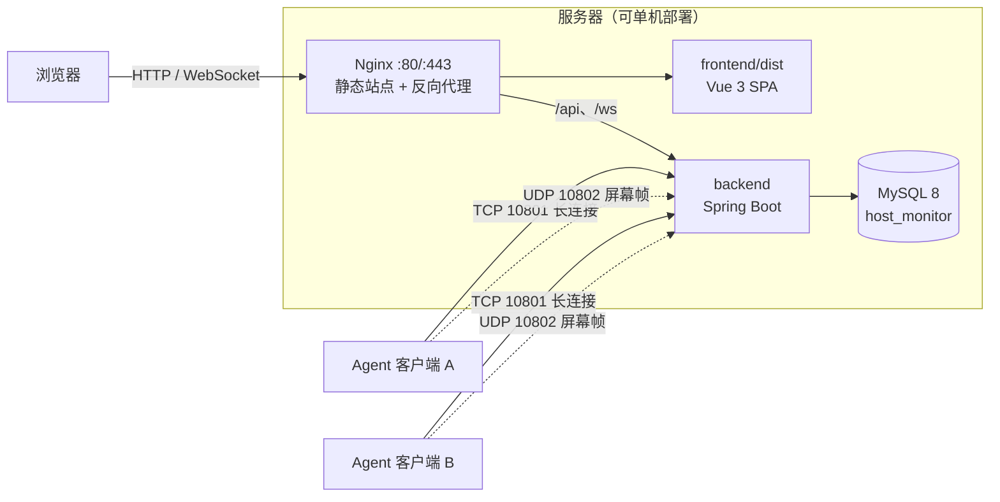

# HostMonitor 部署与配置说明

> 适用代码：HostMonitor（backend 0.0.1-SNAPSHOT / monitor-client 1.0-SNAPSHOT / frontend 0.0.0）
> 关联文档：`architecture.md`（架构、协议、加密）、`api.md`（接口清单与字段）

---

## 1. 部署拓扑与端口

系统由四个部分组成：**MySQL 数据库**、**服务端（backend）**、**前端静态站点（frontend）**、**客户端 Agent（monitor-client，可多台）**。



| 端口 | 协议 | 用途 | 是否需对外开放 |
| --- | --- | --- | --- |
| 10800 | TCP/HTTP | REST API + WebSocket（`/api/**`、`/ws/screen/**`） | 仅对 Nginx 或内网开放 |
| 10801 | TCP | Agent 长连接：认证、指标/进程上报、指令与配置下发 | 对 Agent 网段开放 |
| 10802 | UDP | 屏幕帧传输 | 对 Agent 网段开放 |
| 80 / 443 | TCP/HTTP(S) | Nginx 对外入口（生产建议只开 443） | 对外 |
| 3306 | TCP | MySQL | 仅本机/内网 |
| 5173 | TCP | 前端开发服务器（仅开发环境） | 不需要 |

> ⚠️ 10801/10802 没有 HTTP 语义，**不能**用 Nginx 反代，必须让 Agent 直连服务端地址（同内网或 VPN）。

---

## 2. 环境要求

| 组件 | 版本要求 | 说明 |
| --- | --- | --- |
| JDK | **21**（服务端与客户端都是） | `pom.xml` 中 `<java.version>21</java.version>` |
| Maven | 3.9+ | 构建服务端与客户端 |
| MySQL | 8.0+ | 字符集 `utf8mb4`，需支持 `EVENT`（定时清理） |
| Node.js | `^20.19.0` 或 `>=22.12.0` | 前端 `package.json` 的 `engines` 约束 |
| npm | 10+ | 随 Node 安装 |
| Nginx | 1.20+ | 生产环境托管前端静态资源 + 反向代理 |
| 浏览器 | Chrome / Edge 等现代浏览器 | 屏幕查看依赖 Canvas + WebSocket |

客户端运行前提：

- Windows 建议在**交互式桌面会话**中运行（`AWT Robot` 截屏需要可见桌面；锁屏 / RDP 断开 / headless 环境会截到黑屏）；
- Linux 运行需有 `DISPLAY`（X11 会话）；
- 客户端与服务端之间 UDP 不能有严重丢包，跨公网建议走 VPN/专线。

---

## 3. 部署前检查清单

- [ ] 服务器已安装 JDK 21、MySQL 8、Nginx（如需）
- [ ] 已规划域名 / 证书（生产）
- [ ] 已确定数据库账号密码，并写入环境变量（不要写进代码）
- [ ] 已生成 ≥ 32 字节的 `JWT_SECRET`
- [ ] 已确认防火墙策略：10801/TCP、10802/UDP 对 Agent 网段放行
- [ ] 已确认 Agent 机器与服务器时钟同步（NTP），否则指标时间会漂移

---

## 4. 数据库部署

### 4.1 建库

```sql
CREATE DATABASE host_monitor
  DEFAULT CHARACTER SET utf8mb4
  COLLATE utf8mb4_general_ci;
```

### 4.2 导入初始化脚本

```bash
mysql -u root -p host_monitor < sql/init.sql
```

`sql/init.sql` 做了四件事：

1. 建 16 张表：`group`、`user`、`role`、`user_role`、`permission`、`role_permission`、`host`、`host_metric`、`host_process`、`alert_setting`、`group_setting`、`process_rule`、`alert_record`、`notification`、`user_notification`、`login_attempt`；
2. 初始化 3 个角色、默认管理员、9 条权限及角色-权限关系；
3. 初始化 21 项系统/告警配置（`alert_setting`）；
4. 开启 `event_scheduler` 并创建 3 个清理事件（指标/进程 48 小时、登录记录 24 小时）。

### 4.3 权限注意事项

脚本中的 `SET GLOBAL event_scheduler = ON;` 需要 `SUPER` 或 `SYSTEM_VARIABLES_ADMIN` 权限。若使用云数据库 / 受限账号，可能执行失败，处理方式：

**方案一（推荐）**：导入前先注释掉 `SET GLOBAL ...` 与三个 `CREATE EVENT` 语句，清理工作交给后端自带的 `DataCleanupTask`（见 9.3）。

**方案二**：让 DBA 在 `my.cnf` 中配置 `event_scheduler=ON`（持久化，重启仍生效），再用有权限账号创建事件。

> 注意：`SET GLOBAL` 只在当前 MySQL 实例生命周期内有效，**MySQL 重启后可能恢复为 OFF**，所以生产更推荐方案一或方案二。

### 4.4 初始账号

| 项 | 值 |
| --- | --- |
| 用户名 | `admin` |
| 密码 | `123456` |
| Agent Key | `a1b2c3d4-e5f6-7890-abcd-ef1234567890` |

**首次登录后必须修改密码**（`sql/init.sql` 中的密码为 BCrypt 固定值，公开可见）。

### 4.5 备份

```bash
# 每日备份示例（可放 crontab）
mysqldump -u root -p --single-transaction --routines --events \
  host_monitor > /backup/host_monitor_$(date +%F).sql
```

---

## 5. 服务端部署

### 5.1 配置文件

配置文件：`backend/src/main/resources/application.yml`（生产模板 `application-prod.yml`）。

| 配置项 | 默认/示例 | 说明 |
| --- | --- | --- |
| `server.port` | `10800` | HTTP / WebSocket 端口 |
| `spring.datasource.url` | `jdbc:mysql://localhost:3306/host_monitor?...&serverTimezone=Asia/Shanghai` | 数据库连接串 |
| `spring.datasource.username` | `${DB_USERNAME}` | 走环境变量，无默认值 |
| `spring.datasource.password` | `${DB_PASSWORD}` | 走环境变量，无默认值 |
| `socket.port` | `10801` | Agent TCP 长连接端口 |
| `screen.udp.port` | `10802` | 屏幕帧 UDP 端口 |
| `jwt.secret` | `${JWT_SECRET}` | **必须 ≥ 32 字节（HS256 要求 256 位）** |
| `jwt.expiration` | `86400000` | Token 有效期（毫秒），默认 24 小时 |
| `mybatis-plus.*` | `map-underscore-to-camel-case=true`、逻辑删除 `isDel` | 一般不用改 |
| `management.endpoints.web.exposure.include` | `health,info,metrics` | Actuator 暴露端点 |

环境变量：

| 变量 | 必填 | 说明 |
| --- | --- | --- |
| `DB_USERNAME` | 是 | 数据库账号 |
| `DB_PASSWORD` | 是 | 数据库密码 |
| `JWT_SECRET` | 是 | Token 签名密钥，建议 `openssl rand -base64 48` 生成 |
| `SPRING_PROFILES_ACTIVE` | 否 | 设为 `prod` 时加载 `application-prod.yml` |

> 默认 profile 下 `DB_USERNAME` / `DB_PASSWORD` / `JWT_SECRET` 均为 `${...}` **无默认值**，未设置会启动失败（`Could not resolve placeholder`）。

### 5.2 构建

```bash
cd backend
mvn clean package -DskipTests
# 产物：target/backend-0.0.1-SNAPSHOT.jar
```

### 5.3 启动

```bash
export DB_USERNAME=host_monitor
export DB_PASSWORD='******'
export JWT_SECRET="$(openssl rand -base64 48)"   # 只生成一次并妥善保存，重启必须一致
export SPRING_PROFILES_ACTIVE=prod                # 可选

java -Xms256m -Xmx512m -jar backend-0.0.1-SNAPSHOT.jar
```

### 5.4 使用 systemd 托管（Linux 推荐）

创建 `/etc/systemd/system/hostmonitor.service`：

```ini
[Unit]
Description=HostMonitor Backend
After=network.target mysql.service

[Service]
Type=simple
User=hostmonitor
WorkingDirectory=/opt/hostmonitor
Environment=DB_USERNAME=host_monitor
Environment=DB_PASSWORD=your-password
Environment=JWT_SECRET=your-32-bytes-or-longer-secret
Environment=SPRING_PROFILES_ACTIVE=prod
ExecStart=/usr/bin/java -Xms256m -Xmx512m -jar /opt/hostmonitor/backend-0.0.1-SNAPSHOT.jar
Restart=on-failure
RestartSec=5
StandardOutput=append:/var/log/hostmonitor/backend.log
StandardError=append:/var/log/hostmonitor/backend.err.log

[Install]
WantedBy=multi-user.target
```

```bash
sudo systemctl daemon-reload
sudo systemctl enable --now hostmonitor
sudo systemctl status hostmonitor
sudo journalctl -u hostmonitor -f
```

### 5.5 防火墙放行

```bash
# Ubuntu (ufw)
sudo ufw allow 10800/tcp
sudo ufw allow 10801/tcp
sudo ufw allow 10802/udp

# CentOS (firewalld)
sudo firewall-cmd --permanent --add-port=10800/tcp
sudo firewall-cmd --permanent --add-port=10801/tcp
sudo firewall-cmd --permanent --add-port=10802/udp
sudo firewall-cmd --reload
```

Windows 服务端可用：

```powershell
New-NetFirewallRule -DisplayName "HostMonitor TCP 10801" -Direction Inbound -Protocol TCP -LocalPort 10801 -Action Allow
New-NetFirewallRule -DisplayName "HostMonitor UDP 10802" -Direction Inbound -Protocol UDP -LocalPort 10802 -Action Allow
```

### 5.6 健康检查

Actuator 端点在 `SecurityConfig` 中属于"需认证"路径，需带 Token：

```bash
TOKEN=$(curl -s -X POST http://127.0.0.1:10800/api/auth/login \
  -H "Content-Type: application/json" \
  -d '{"username":"admin","password":"123456"}' | sed -E 's/.*"token":"([^"]+)".*/\1/')

curl -H "Authorization: Bearer $TOKEN" http://127.0.0.1:10800/actuator/health
# {"status":"UP"}
```

若没有 Token，也可用端口探测代替：

```bash
ss -lntp | grep -E '10800|10801'
ss -lnup | grep 10802
```

### 5.7 日志

- `logback` 默认输出到控制台：systemd 场景由 journald 收集（`journalctl -u hostmonitor`）；
- 上面示例用 `StandardOutput=append:` 落文件，配合 `logrotate` 切割；
- 业务错误统一由 `GlobalExceptionHandler` 记录，排障时优先看该日志。

---

## 6. 前端部署

### 6.1 开发环境

```bash
cd frontend
npm install
npm run dev        # http://localhost:5173
```

`vite.config.ts` 已配置代理：`/api` → `http://localhost:10800`，`/ws` → `ws://localhost:10800`（含 `ws: true`）。

### 6.2 生产构建

```bash
cd frontend
npm install
npm run build      # 先 vue-tsc 类型检查，再 vite build
# 产物：dist/
```

Node 版本不满足 `engines` 时 npm 会告警甚至失败，建议用 `nvm` 切到 Node 22 LTS。

### 6.3 Nginx 配置示例

```nginx
server {
    listen 80;
    server_name monitor.example.com;
    # 生产建议 80 跳 443
    # return 301 https://$host$request_uri;

    root /usr/share/nginx/html/hostmonitor;   # 上传 dist/ 内容
    index index.html;

    # 前端为 history 路由，刷新子路径需回退到 index.html
    location / {
        try_files $uri $uri/ /index.html;
    }

    # REST 接口（后端本身就以 /api 开头，这里不做路径重写）
    location /api/ {
        proxy_pass http://127.0.0.1:10800;
        proxy_set_header Host $host;
        proxy_set_header X-Real-IP $remote_addr;
        proxy_set_header X-Forwarded-For $proxy_add_x_forwarded_for;
        proxy_set_header X-Forwarded-Proto $scheme;
        proxy_read_timeout 60s;
    }

    # WebSocket 屏幕流：必须转发 Upgrade/Connection
    location /ws/ {
        proxy_pass http://127.0.0.1:10800;
        proxy_http_version 1.1;
        proxy_set_header Upgrade $http_upgrade;
        proxy_set_header Connection "upgrade";
        proxy_set_header Host $host;
        proxy_set_header X-Real-IP $remote_addr;
        proxy_read_timeout 3600s;
    }

    # 可选：压缩
    gzip on;
    gzip_types text/css application/javascript application/json image/svg+xml;
    gzip_min_length 1k;

    # 静态资源缓存（dist 文件名带 hash，可长缓存）
    location ~* \.(js|css|png|jpg|jpeg|svg|woff2?)$ {
        expires 30d;
        add_header Cache-Control "public, immutable";
    }
}
```

### 6.4 HTTPS / WSS

- 用 `certbot` 或云厂商证书配置 443；
- 页面走 `https://` 时，前端自动把 WebSocket 拼成 `wss://`（`ScreenView.vue` 按当前页面协议选择 `ws`/`wss`），无需改代码；
- 若使用自签证书，浏览器会拦截 `wss`，不建议生产使用。

---

## 7. 客户端（Agent）部署

### 7.1 配置文件

位置：`monitor-client/src/main/resources/application.properties`

| 配置项 | 默认值 | 说明 |
| --- | --- | --- |
| `socket.host` | `127.0.0.1` | **服务端 IP/域名**（部署时必改） |
| `socket.port` | `10801` | 服务端 TCP 端口 |
| `agent.key` | 默认超管的 Key | **该 Agent 所属用户的 Agent Key**（必改） |
| `screen.enabled` | `true` | 是否启用屏幕推流功能 |
| `screen.udp.port` | `10802` | 屏幕帧 UDP 端口（需与服务端一致） |
| `screen.fps` | `5` | 初始帧率（运行时以服务端下发配置为准） |
| `screen.jpeg.quality` | `0.5` | 初始 JPEG 质量 0～1（运行时以服务端下发为准） |
| `metric.interval.ms` | `5000` | 指标采集间隔（运行时以服务端下发为准） |
| `process.interval.ms` | `15000` | 进程采集间隔（运行时以服务端下发为准） |

- **Agent Key 与服务端用户一一对应**，一个用户只能绑定一台主机（`host.user_id` 唯一）。要接多台机器就创建多个用户，每个用户配自己的 Key。
- Agent Key 在用户管理页面可见；超管可调用 `POST /api/users/{id}/reset-agent-key` 重置（会踢掉旧连接）。
- 客户端认证成功后，服务端会下发 `CONFIG`，覆盖采集间隔/帧率/画质等参数；之后超管在系统设置/组设置里修改，会通过长连接 `CONFIG_UPDATE` **热更新**，无需重启客户端。

### 7.2 构建与运行

客户端是**普通 Java 程序**（非 Spring Boot 应用，没有内嵌容器），推荐两种运行方式：

**方式一：IDE 直接运行（开发/单机最常用）**

直接运行主类 `com.ylh.client.MonitorClient`（IDEA 中 Run `MonitorClient`）。

**方式二：打包分发**

```bash
cd monitor-client
mvn -q clean package dependency:copy-dependencies -DincludeScope=runtime

# Windows（classpath 分隔符为 ;）
java -cp "target/classes;target/dependency/*" com.ylh.client.MonitorClient

# Linux / macOS（分隔符为 :）
java -cp "target/classes:target/dependency/*" com.ylh.client.MonitorClient
```

也可以在项目目录直接：

```bash
mvn -q compile exec:java -Dexec.mainClass=com.ylh.client.MonitorClient
```

> 修改 `application.properties` 后需要**重新编译/重新打包**才生效（配置从 classpath 读取）。

### 7.3 开机自启 / 进程守护

**Windows**（推荐 NSSM 注册为服务，或任务计划程序）：

```powershell
# NSSM 示例（需将 java 路径与工程路径替换为实际值）
nssm install HostMonitorAgent "C:\Program Files\Java\jdk-21\bin\java.exe"
nssm set HostMonitorAgent AppParameters "-cp \"D:\hostmonitor-agent\classes;D:\hostmonitor-agent\dependency\*\" com.ylh.client.MonitorClient"
nssm set HostMonitorAgent AppDirectory "D:\hostmonitor-agent"
nssm set HostMonitorAgent Start SERVICE_AUTO_START
nssm start HostMonitorAgent
```

**Linux**（systemd，需图形会话）：

```ini
[Unit]
Description=HostMonitor Agent
After=graphical.target

[Service]
Type=simple
User=monitor
Environment=DISPLAY=:0
WorkingDirectory=/opt/hostmonitor-agent
ExecStart=/usr/bin/java -cp "/opt/hostmonitor-agent/classes:/opt/hostmonitor-agent/dependency/*" com.ylh.client.MonitorClient
Restart=always
RestartSec=10

[Install]
WantedBy=graphical.target
```

### 7.4 屏幕采集前提

- 必须在**已登录的桌面会话**中运行；Windows 服务方式（Session 0）截不到用户桌面，NSSM 安装时需以当前用户身份运行或改用任务计划程序"用户登录时启动"；
- 多显示器会自动合并为一张图（`ScreenCapture` 汇总所有 `GraphicsDevice`）；
- 宽度超过 1280 会等比缩放，JPEG 目标 ≤ 45KB，超限会自动降质量重压。

---

## 8. 配置生效顺序与热更新

### 8.1 生效优先级（服务端 → 客户端）

| 优先级 | 来源 | 说明 |
| --- | --- | --- |
| 1（最高） | 分组设置 `group_setting` | 组级覆盖值，仅对组内成员生效 |
| 2 | 全局设置 `alert_setting` | 系统设置页修改的全局值 |
| 3 | 客户端 `application.properties` | 仅作为初始值/兜底 |

### 8.2 生效时机

| 配置 | 生效方式 |
| --- | --- |
| 客户端采集间隔、屏幕帧率/画质、进程 CPU 阈值、心跳超时 | 认证时下发 `CONFIG`；修改后经 `CONFIG_UPDATE` 热更新，**无需重启** |
| JWT 密钥、端口、数据库连接 | 修改后需**重启后端** |
| 告警阈值、告警开关、去重窗口 | 下一次告警检测（≤30s）即生效，无需重启 |
| SMTP 邮件参数 | 保存后下一次发送生效；可用"发送测试邮件"验证 |
| 前端页面 | 替换 `dist/` 后刷新浏览器 |

### 8.3 数据清理

系统存在**两套**清理机制：

| 机制 | 位置 | 清理内容 |
| --- | --- | --- |
| MySQL 事件 | `sql/init.sql` 的 `ev_clean_*` | `host_metric` / `host_process` 48 小时前；`login_attempt` 24 小时前 |
| 后端定时任务 | `DataCleanupTask`（`@Scheduled(cron = "0 0 3 * * ?")`） | 按 `data_retention_days`（默认 2 天）清理指标/进程；按 `notification_retention_days`（默认 30 天）清理通知 |

两者幂等、重复执行没有副作用，但**建议只保留一种**，避免日志噪音和双重压力。

---

## 9. 生产安全清单

- [ ] 修改默认管理员密码（`admin/123456` 不可用于生产）
- [ ] `JWT_SECRET` 使用 ≥ 32 字节随机值，独立于代码，妥善保存（更换后所有 Token 失效）
- [ ] 数据库使用最小权限账号，仅授权 `host_monitor` 库
- [ ] 收紧 CORS：当前 `SecurityConfig` 为 `allowedOriginPatterns("*") + allowCredentials(true)`，生产应改为实际域名
- [ ] 10801/TCP、10802/UDP **不要暴露公网**；用安全组/VPN/白名单限制来源
- [ ] Nginx 启用 HTTPS，WebSocket 用 `wss`
- [ ] Nginx 对 `/ws/` 的 access log 做脱敏或关闭 query 记录（JWT 在 URL 中）
- [ ] 限制 `/actuator/**` 仅内网可访问（当前需 Token，但 Token 可被复用）
- [ ] 数据库定时备份 + 定期恢复演练
- [ ] Agent Key 视为密码：泄露等于可冒名上报；员工离职/换机时重置
- [ ] 服务器与 Agent 开启 NTP 时间同步
- [ ] SMTP 授权码等敏感配置优先走环境变量/密钥管理，而不是明文存库

---

## 10. 运维与排障

| 现象 | 可能原因 | 排查方式 |
| --- | --- | --- |
| 启动报 `Could not resolve placeholder 'DB_USERNAME'` | 环境变量未设置 | 检查 `env | grep DB_` / systemd `Environment=` |
| 启动报 `WeakKeyException` | `JWT_SECRET` 少于 32 字节 | 换用 `openssl rand -base64 48` |
| 启动报 `Access denied for user` | 数据库账号/密码/权限错误 | `mysql -u xxx -p` 手动登录验证 |
| 启动报 `Unknown database 'host_monitor'` | 未建库或未导入 | 执行第 4 章 |
| 端口被占用 | 旧进程未退出 | `ss -lntp | grep 10800` / `netstat -ano | findstr 10800` |
| 登录返回 429 / 423 | 触发 IP 限速或账号锁定 | 等待 15 分钟，或清理 `login_attempt` 表中对应记录 |
| 登录成功但接口 401 | Token 过期；Nginx 未代理 `/api`；前端 baseURL 配置错误 | 浏览器 Network 看请求地址与 Header |
| 主机一直显示离线 | Agent 连不上 10801；`agent.key` 与用户不匹配；同用户被新连接踢掉 | 服务端日志看 `ClientHandler` 认证失败；`telnet server 10801` |
| 屏幕黑屏 / 无画面 | UDP 10802 被防火墙拦；`screen.enabled=false`；客户端在锁屏/无桌面会话；无权限订阅 | 服务端日志看 UDP 收帧与 WS 订阅；检查 WS 握手是否被 403 |
| 画面卡顿 / 花屏 | UDP 丢包/乱序、跨公网质量差、JPEG 过大 | 降低 `client_screen_fps` / `client_screen_jpeg_quality`；改走内网/VPN |
| 状态不更新但进程正常 | 心跳超时配置过小 / 服务端时间异常 | 检查 `client_heartbeat_timeout_ms`（默认 60s） |
| 告警不触发 | 告警开关关闭、阈值过高、进程规则未配置、去重窗口内 | 检查 `alert_setting`、分组 `process_rule`、`alert_dedup_minutes` |
| 邮件发不出 | `email_enabled=false`、SMTP 参数错误、465 端口被拦、授权码失效 | 先调 `POST /api/system-settings/email/test`，看服务端异常栈 |
| 页面刷新 404 | Nginx 未配置 `try_files ... /index.html` | 检查 Nginx 配置并 reload |
| WebSocket 连不上 | 未转发 `Upgrade`/`Connection`；`wss` 证书问题；跨域 | 浏览器 Console 看握手错误；`curl -i -N -H "Connection: Upgrade" -H "Upgrade: websocket"` |
| 时间显示偏差 8 小时 | 数据库连接未带 `serverTimezone=Asia/Shanghai`；客户端时钟不同步 | 检查 JDBC URL 与 NTP |

常用日志关键字：`Auth timeout`、`Not authenticated`、`ECDH`、`PROCESS_RESYNC`、`screen`、`WebSocket`。

---

## 11. 升级与回滚

### 11.1 后端升级

```bash
# 1) 备份
cp backend-0.0.1-SNAPSHOT.jar /backup/backend-$(date +%F).jar
mysqldump -u root -p host_monitor > /backup/db-$(date +%F).sql

# 2) 停服 → 替换 → 启服
sudo systemctl stop hostmonitor
cp new/backend-0.0.1-SNAPSHOT.jar /opt/hostmonitor/
sudo systemctl start hostmonitor

# 3) 冒烟：登录 → 主机列表 → 主机详情 → 屏幕查看 → 告警列表
```

> 若版本包含表结构变更，必须先执行对应 SQL 迁移脚本，再启动新版本。

### 11.2 前端升级

```bash
npm run build
rsync -av --delete dist/ /usr/share/nginx/html/hostmonitor/
sudo nginx -t && sudo systemctl reload nginx
```

### 11.3 客户端升级

1. 替换客户端 jar/classes 与 `application.properties`（`agent.key` 保持不变，否则要重新绑定）；
2. 重启客户端进程；
3. 服务端"主机管理"中确认 `lastHeartbeat` 已更新、状态回到在线。

### 11.4 回滚

- 后端：换回备份 jar → 重启；若执行过表结构变更，用备份 SQL 恢复（**先确认数据可丢范围**）；
- 前端：切回上一版 `dist`；
- 客户端：换回旧版本程序。

---

## 12. 已知限制

1. 仓库内**没有** `Dockerfile` / `docker-compose` / Nginx 配置，本文档给出的是参考配置，需按实际环境调整；
2. 服务端为**单实例**设计：TCP 连接表、UDP 分包缓存、WebSocket 会话都在本机内存，直接多实例部署会导致订阅/推流失效（要扩展需引入共享会话/消息总线）；
3. 进程增量上报后仍**全量落库**（`batchInsert` 整个快照），数据量大时需优化为只写变更；
4. WebSocket 的 JWT 放在 URL query 上，存在日志泄露风险；
5. CORS 当前放开为 `*`，生产需收紧；
6. 无内置 HTTPS，需要 Nginx/网关终止 TLS；
7. 双清理机制（MySQL 事件 + Java 定时任务）并存，建议二选一；
8. 无接口版本化（`/api/v1`），升级需前后端同步发布。

---

## 13. 附录

### 13.1 启动顺序

```
MySQL → backend（10800/10801/10802） → Nginx + 前端静态资源 → 各 Agent 客户端
```

停止顺序相反。**先启动后端再启动 Agent**，否则 Agent 会进入重连等待。

### 13.2 最小验证清单（部署后 5 分钟冒烟）

1. `curl http://127.0.0.1:10800/api/auth/login`（POST）返回 `code=200` 且有 token；
2. 浏览器打开前端，`admin/123456` 登录成功；
3. 启动一个 Agent，主机管理出现该主机且状态在线；
4. 主机详情能看到 CPU/内存/磁盘曲线；
5. 点"屏幕监控"能看到实时画面（10802/UDP 通）；
6. 触发一次阈值告警（把 `cpu_threshold` 临时调到 1），告警中心出现记录；
7. 修改 `client_screen_fps`，刷新屏幕页观察帧率变化（验证热更新链路）。
